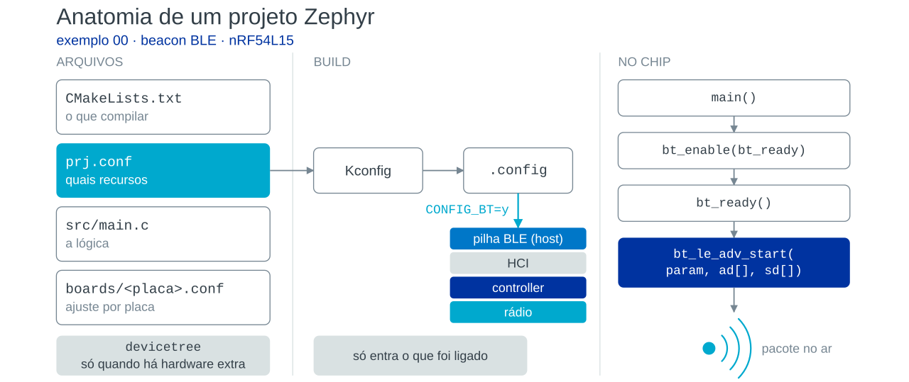
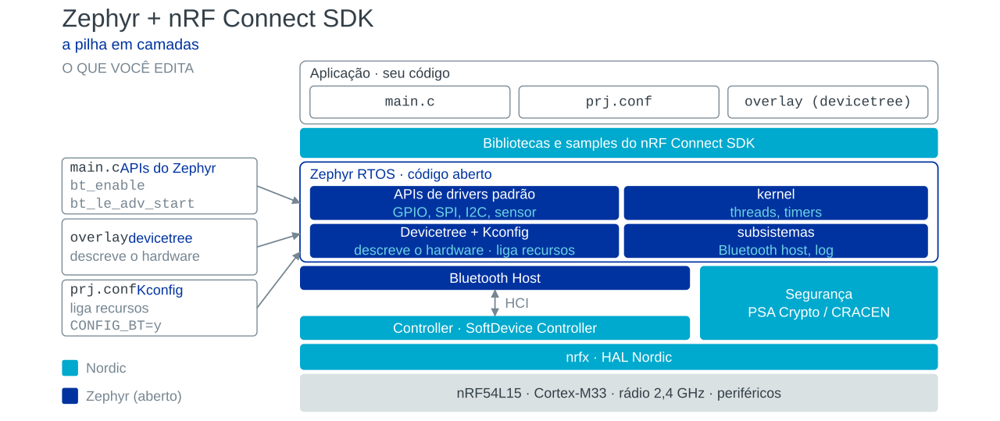

# 00-starter — beacon BLE mínimo (nRF54L15)

Anuncia um pacote BLE conectável com Flags, dado do fabricante (ID `0x0059` + `AA BB CC DD`) e, na resposta de scan, o nome `Test beacon`. Serve para mostrar a anatomia de um projeto Zephyr / nRF Connect SDK: `CMakeLists.txt` (o que compilar), `prj.conf` (quais recursos), `src/main.c` (a lógica) e `boards/<placa>.conf` (ajuste por placa).





## Três experimentos

| Experimento | Onde mudar | Como |
|---|---|---|
| Intervalo de advertising | `src/main.c`, `adv_param` | trocar `BT_GAP_ADV_FAST_INT_MIN_2/MAX_2` (~100–150 ms) por `BT_GAP_ADV_SLOW_INT_MIN/MAX` (~1.000–1.200 ms) |
| Resposta de scan | `src/main.c`, `bt_le_adv_start(...)` | `sd, ARRAY_SIZE(sd)` → `NULL, 0`: sem `sd[]` **e** sem `BT_LE_ADV_OPT_CONN` (anúncio não conectável) o rádio só transmite; com `CONN` o receptor continua ligado para ouvir pedidos de conexão |
| Potência de TX | `prj.conf` | descomentar uma linha: `CONFIG_BT_CTLR_TX_PWR_MINUS_10`, `_0` (padrão), `_PLUS_4` ou `_PLUS_8` (−10 a +8 dBm) |

## Compilar

```sh
west build -b nrf54l15tag/nrf54l15/cpuapp
```

Para o DK: `west build -b nrf54l15dk/nrf54l15/cpuapp`. O log serial imprime `Beacon started, advertising as <endereço>`.

Material de apresentação: `docs/workshop/00-estrutura-projeto-zephyr.pptx` (na raiz do repositório).
